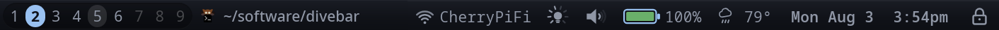

# Divebar

A relatively simple status bar for Linux that uses HTML/CSS for nice styling
and layout. Built with [Tauri](https://tauri.app), in the spirit of polybar.
I was kinda annoyed that polybar and other similar projects are so bad at
styling compared to what you can get with HTML/CSS, simple stuff like proper
text truncation, dynamic sizing, and so on. So, I made this project to get a
simple status bar that actually does have sane layout and formatting options.



## ⚠️ Slop Alert! ⚠️

This project is wholly vibe coded. I made it for personal usage, but just
thought you should know.

## Status

Working prototype. The bar spans the top of the primary monitor, registers
itself as an X11 dock (so EWMH-compliant window managers reserve space for it
via `_NET_WM_STRUT_PARTIAL`), and shows a hardcoded set of widgets:

- **workspaces** — herbstluftwm tag switcher (click to switch; live via
  `herbstclient --idle`)
- **window-title** — focused window title, expands to fill spare space
  (flex-grow) with ellipsis truncation; configurable text alignment
- **wifi** — SSID + signal %; click launches `/usr/local/bin/wifi-gui`
- **volume** — level via wpctl; click opens a pop-down slider, clicking the
  icon toggles mute
- **brightness** — level via brightnessctl; click opens a pop-down slider
- **battery** — charge % + charging state (auto-hides on desktops)
- **tray** — system tray via the StatusNotifierItem D-Bus protocol (divebar
  acts as the tray host); left click activates, middle click secondary,
  right click opens the item's menu. Legacy XEmbed-only tray apps are not
  supported
- **date** — "Fri Jul 31" (fixed width; optional year)
- **time** — "2:27pm" (fixed width; optional 24-hour / seconds)

Also available but not in the default config: **spacer** (invisible,
configurable flex-grow — for pushing widget groups apart), **weather**
(wttr.in, no API key; icon + temp, details in tooltip, click opens a
3-day forecast pop-down, IP-based location unless configured), **media**
(MPRIS: album art + track, click play/pause, middle-click next, hides
itself when no player is running), **lock** (padlock icon, click runs
`slock`), **files** (folder icon, click launches `pcmanfm`).

The date widget's click opens a month calendar; tooltips are custom
styled panels; the Bar section of settings includes height, padding,
accent color, and font. Resuming from suspend (detected via logind's
`PrepareForSleep` signal) forces an immediate stats/weather refresh
rather than waiting on the next poll.

## Configuration

Config lives in `~/.local/config/divebar/config.json` (created with
defaults on first run; hand-editable). Layout is edited on the bar
itself: pick "Edit bar layout…" from any widget's right-click popup (or
the settings window) to drag widgets around in place, remove them with
their ✕ badges, and add new ones from the toolbar that drops down under
the bar (the bar is one flex row; every widget sizes to its content, and
window-title flex-grows). Right-click a widget to edit its options
inline, with a "divebar settings…" link down to the settings window
(which holds the bar-level settings); right-clicking empty bar space
opens the settings window directly. Every change saves and applies to
the bar instantly.

## Running

```sh
cd src-tauri
cargo run            # or: cargo tauri dev
```

Or via make: `make build` (release), `make install` (to
`$(PREFIX)/bin`, default `/usr/local` — `sudo make install`),
`make uninstall`, `make run`, `make clean`.

No Node/npm needed to run the bar — the frontend is plain ES modules served
from `src/` and embedded at compile time (`withGlobalTauri` provides the
Tauri API). Note that frontend changes therefore require a rebuild, even
under `cargo tauri dev`.

Node is only needed for the frontend unit tests (`tests/`, Vitest +
jsdom): `npm install && npm test`.

## HiDPI

WebKitGTK only scales by the integer GDK window scale and ignores font DPI
(`Xft.dpi`), so on HiDPI setups the bar can render tiny. divebar zooms the
webview to compensate: it honors a `DIVEBAR_ZOOM` env var (e.g.
`DIVEBAR_ZOOM=1.5`), falls back to autodetecting `Xft.dpi`/XSETTINGS, and
scales the bar height to match.

## Architecture

```
src/                    # frontend (no bundler)
├── index.html          # bar shell: a single flex row
├── style.css           # bar chrome + shared .chip styling + CSS variables
├── main.js             # widget registry: loads config, mounts widgets
├── settings.html/js/css# settings window (separate floating dialog)
├── lib/                # shared frontend helpers:
│   ├── coordinator.js   #   owns the popup space; arbitrates panel claims
│   ├── popup.js         #   interactive panels (chrome, dismissal)
│   ├── tooltip.js       #   passive panels, fed by the `title` attribute
│   ├── panel.js         #   low-level DOM helpers (centering, animation)
│   ├── bar-config.js    #   bar-level settings schema/defaults + CSS vars
│   ├── meter.js         #   shared toolkit for 0-100 "meter chip" widgets
│   ├── settings-form.js #   renders a settings schema into form controls
│   ├── layout-edit.js   #   in-place bar layout editor
│   └── slider-popup.js, calendar-popup.js, menu-popup.js, widget-settings-popup.js
│                        #   panel bodies: volume/brightness, date, tray, per-widget settings
└── widgets/*.js        # one self-contained file per widget (+ index.js manifest)
src-tauri/
├── src/main.rs         # window creation: undecorated, full-width, top edge
├── src/linux.rs        # X11 dock type hint + strut (space reservation)
├── src/config.rs       # config load/save (~/.local/config/divebar/)
├── src/events.rs       # event-channel plumbing: emit+cache, Trigger, spawn_poll_loop
├── src/stats.rs        # background thread emitting `divebar://stats` events
├── src/hlwm.rs         # herbstclient --idle watcher → `divebar://hlwm` events
├── src/tray.rs         # StatusNotifierItem tray host → `divebar://tray` events
├── src/media.rs        # MPRIS watcher → `divebar://media` events
├── src/weather.rs      # wttr.in poller → `divebar://weather` events
├── src/resume.rs       # logind PrepareForSleep watcher → forces a refresh
├── src/icons.rs        # freedesktop icon theme lookup
├── src/xicon.rs        # X11 _NET_WM_ICON fetch/cache for window icons
├── src/readers.rs      # volume/brightness/wifi readers (shared by both below)
└── src/commands.rs     # control commands: tag switch, volume, brightness, …
```

### Widget contract

Each widget is one file in `src/widgets/` that default-exports:

```js
export default {
  name: "mywidget",        // unique id, matches the filename
  css: `...`,              // widget-scoped CSS, injected once by the registry
  settings: [              // optional: schema the settings UI renders
    // { key, label, type: "boolean"|"number"|"select"|"text",
    //   default, min?, max?, choices? }
  ],
  create(ctx) {
    // ctx.options — the options object from config.js
    // ctx.onStats(cb) — subscribe to system stats; returns unsubscribe fn.
    //                   Replays the latest payload on subscribe.
    // ctx.onEvent(name, cb) — same, for any backend event channel
    //                         (e.g. "divebar://hlwm" for WM state)
    // ctx.invoke / ctx.listen — raw Tauri IPC for widgets with custom needs
    const el = document.createElement("div");
    el.className = "chip";  // opt into the shared chip look (optional)
    return { el, destroy() { /* cleanup */ } };
  },
};
```

To add a widget: drop the file in `src/widgets/`, list it in
`src/widgets/index.js` (the manifest the add-widget picker reads), and
put it on the bar via the layout editor or the config file. `ctx.options`
arrives pre-merged with the schema's defaults.

System data flows one way, over named event channels emitted through
`events.rs` (`divebar://<name>`) — each emit is also cached, so a
late-subscribing widget (or the webview reloading) catches up on the
latest payload via the `get_latest_states` command instead of waiting
for the next event:

- `stats` — `stats.rs` polls battery, volume, brightness, and wifi every
  2s. To expose a new stat, extend the payload (add a reader in
  `readers.rs` if a command also needs it).
- `hlwm` — pushed immediately on every WM event (tag switches,
  focus/title changes) via a persistent `herbstclient --idle` process.
- `tray` — pushed on every StatusNotifierItem change (`tray.rs`).
- `media` — pushed on MPRIS player/property changes (`media.rs`).
- `weather` — polled from wttr.in (`weather.rs`); only emits on a
  successful fetch, so stale data is left up rather than blanked, and a
  channel with no fetch yet is simply absent from the replay.

User-initiated controls go the other way as Tauri commands
(`src-tauri/src/commands.rs`): widget actions like `hlwm_use_tag`,
`set_volume`, `toggle_mute`, `set_brightness`, `display_off`,
`media_control`, `tray_activate`, `tray_menu_click`, `launch_wifi_gui`,
`lock_screen`, `launch_file_manager`, and `resolve_location`; plus `set_popup_open` (panel
space, see below) and the config/settings plumbing (`get_config`,
`get_default_config`, `save_config`, `open_settings`, `close_settings`,
`list_fonts`, `get_env`). Commands that change a value return the fresh
state so widgets update instantly rather than waiting for the next poll.

### Pop-down panels

The window is actually taller than the bar (`POPUP_SPACE` in `main.rs`):
the transparent strip below the bar hosts pop-down panels — the
volume/brightness sliders, the date widget's calendar, the tray item's
menu, weather's forecast, and per-widget/bar settings. Only one can be
open at a time; `src/lib/coordinator.js` arbitrates: panels (popups and
tooltips) claim the popup space, a popup beats a tooltip, and the
Coordinator is the sole caller of `set_popup_open`. An X11 input shape
normally restricts pointer input to the bar strip so the popup space is
click-through; while a panel is open, `set_popup_open` expands the input
region to the full window (and clicking outside the panel closes it and
shrinks the region back). Only the bar strip is reserved via strut.

## Roadmap / non-goals of the prototype

- **Wayland** — space reservation currently uses X11 struts; Wayland support
  would go through `gtk-layer-shell` in `linux.rs`.
- **More widgets** — notifications.
- **Multi-monitor** — one bar per monitor.
